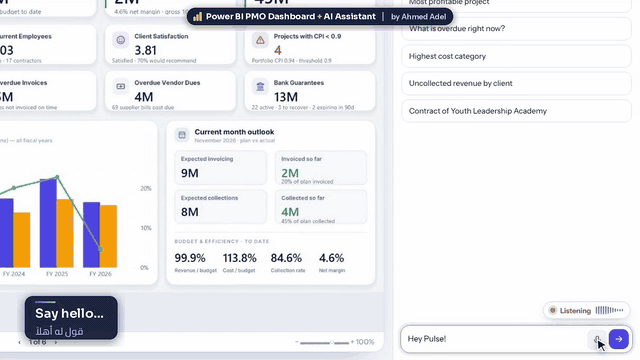
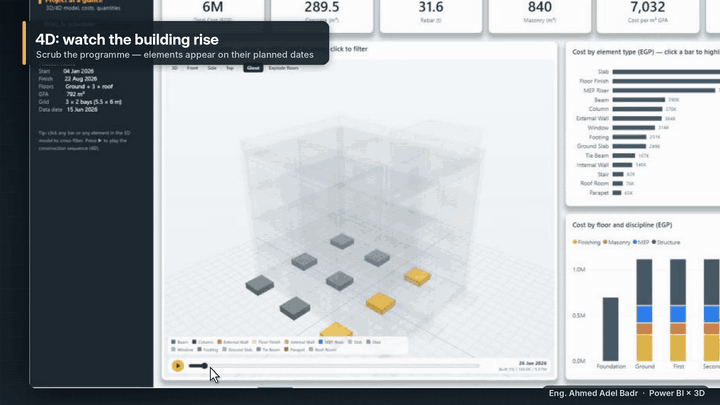

<h1 align="center">Ahmed Adel Badr</h1>
<h3 align="center">Data Engineer · BI Developer · AI Automation</h3>

SQL · Python · Data Architecture · Power BI · LLMs: Claude · ChatGPT · Gemini · Ollama

  
  
  
  
  
  
  
  
  
  
  

---

### 👋 About me

I build the data layer behind decisions: from **source systems and databases**, through **SQL pipelines and data models**, to **Power BI dashboards** and **AI assistants** that let people ask their data questions in plain language.

- 🏗️ **Data architecture & engineering:** designed and built databases for **10+ Saudi government entities**, integrating them with different platforms and analysing them in SQL.
- 📊 **BI:** Power BI dashboards for every level of an organisation, from the board to operations teams, over a portfolio worth about **SAR 250M**.
- 🤖 **AI automation:** automations that replaced hours of manual work: scheduled reports, instant email alerts, and an AI assistant that answers questions about a Power BI report.
- 👥 Lead a data team of 8, including 2 AI engineers.
- 🌍 Open to **remote** Data Engineer, BI Developer and Analytics Engineer roles.

---

### 🎬 Showcase

<table>
<tr>
<td width="50%" valign="top">

**Power BI dashboard + AI assistant**

An executive dashboard with **Pulse**, an AI assistant that answers questions about revenue, costs, collections and overdue items by voice or text, in **English and Arabic**. It uses the same KPIs and formulas as the Power BI model (93 measures), behind a secure sign-in.

`Power BI` `DAX` `Power BI REST API` `Python` `SQLite` `LLM (Ollama)`

https://github.com/user-attachments/assets/91c63f40-2d89-4333-8be7-cb03cfb1a5d6

</td>
<td width="50%" valign="top">

**4D model inside Power BI**

A 3D model rendered inside Power BI and driven by a schedule: scrub the timeline and elements appear on their planned dates. Every element carries its type, floor, cost and dates, and the quantities, S-curve and cash flow roll up from the same data.

`Power BI` `Custom 3D visual` `DAX` `Data modeling`

https://github.com/user-attachments/assets/72c91a53-4229-40c0-8077-59634d7a95a1

</td>
</tr>
</table>

---

### 🗂️ Featured projects

| Project | What it is | Stack |
|---|---|---|
| [**SQL Data Warehouse**](https://github.com/AhmedAdelBadr/sql-data-warehouse-project) | Medallion warehouse (Bronze → Silver → Gold) that merges CRM and ERP data into a star schema, with ETL procedures and data-quality tests | SQL Server, T-SQL, Docker |
| [**Portfolio Analytics in SQL**](https://github.com/AhmedAdelBadr/pmo-portfolio-sql-analytics) | Semantic layer over a project portfolio: earned-value forecasts, trends, risk heat map, data-quality checks | PostgreSQL, Docker, GitHub Actions |
| [**Sales & Ads Funnel Analytics**](https://github.com/AhmedAdelBadr/real-estate-sales-sql-analytics) | Ad → lead → sale funnel, cost per sale, cohorts, attribution and action lists for stale listings | PostgreSQL, Docker, GitHub Actions |
| [**Dashboards portfolio**](https://ahmedadelbadr.github.io/Portofolio) | Power BI dashboards and the database-to-dashboard journey behind them | Power BI, DAX, Power Query |

**Python & machine learning**

| Project | Topic |
|---|---|
| [Image Classifier](https://github.com/AhmedAdelBadr/Image_Classifier_Master) | Deep-learning image classification app (PyTorch) |
| [Finding Donors for CharityML](https://github.com/AhmedAdelBadr/-Finding-Donors-For-CharityML) | Supervised learning to predict likely donors |
| [Student Admissions](https://github.com/AhmedAdelBadr/Student-Admission) | Neural network from scratch |
| [Titanic Survival Exploration](https://github.com/AhmedAdelBadr/Udacity-Titanic_Survival_Exploration-Solution) | Exploratory data analysis and decision rules |

---

### 🛠️ Toolbox

**Databases & SQL:** SQL Server (T-SQL) · PostgreSQL · SQLite · window functions · CTEs · stored procedures  
**Data engineering:** Medallion architecture · ETL / ELT · star-schema modeling · data-quality testing · API integrations  
**Python:** pandas · NumPy · SQLAlchemy · Flask · Jupyter · scikit-learn  
**BI:** Power BI · DAX · Power Query · Power BI REST API · Excel (Power Pivot) · Tableau  
**AI:** Claude · ChatGPT · Gemini · Ollama · LLM assistants over company data · report and alert automation  
**Engineering practice:** Git & GitHub · GitHub Actions · Docker

---

### 📫 Contact

The fastest way to reach me is LinkedIn.
